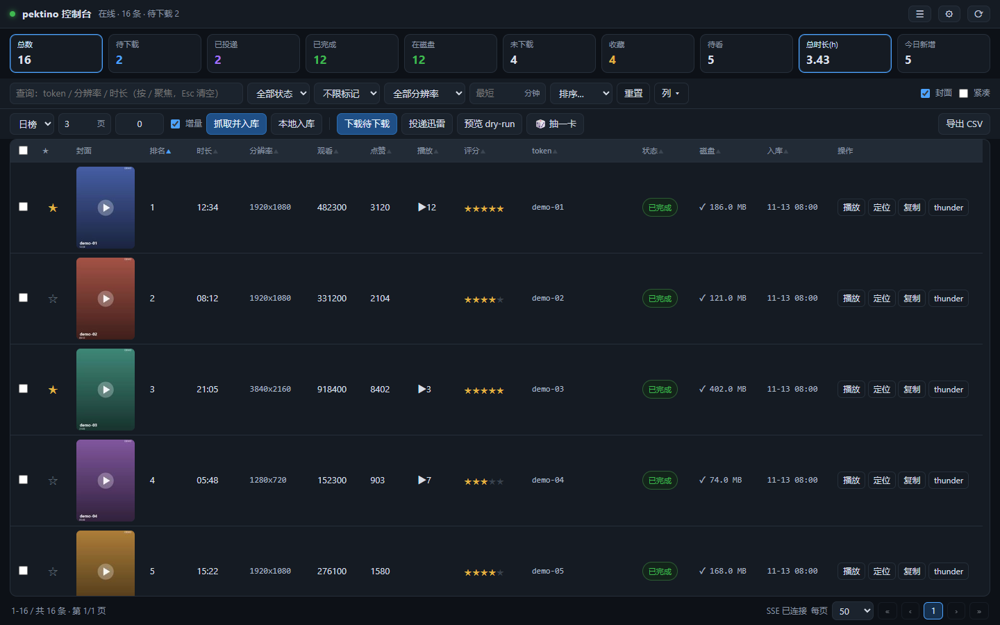

# pektino

本地的视频台账与下载管理工具：抓榜单 → 生成直链 → 内置下载器 → 扫盘回填 → 打分 / 收藏 / 待看 / 抽卡。

全程在你自己的电脑上运行，服务只监听 `127.0.0.1`，数据不上传。

当前版本：**v1.0.0** · [更新日志](CHANGELOG.md)

- 程序的界面是中文
- 数据来源是第三方站点 `pektino.com`，需要能访问它
- 内置下载器支持并发（1–16）、断点续传、暂停 / 继续（可整体、也可单条）
- 台账支持 **表格 / 画廊** 两种视图，封面直接用高清原图
- **合集**：独立的合集管理，支持新建/重命名/删除、右键或批量加入，可按合集筛选
- **批量操作**：多选后可下载、加入合集、移入回收站、标记、评分
- 下载失败可一键重试；控制台重启后会提示继续上次没下完的条目
- 没有封面的本地视频会自动**用视频帧当封面**（不联网、不需要 ffmpeg）；本地文件自动补时长/分辨率
- 中文文件名的视频也能在浏览器里播放
- 预览封面点一下就能**在浏览器里播放**，**Ctrl+←/→** 切换上一项/下一项（也保留系统播放器）
- 支持**画中画**（切出去继续看）和播放快捷键：空格 播放/暂停、F 全屏、M 静音
- 下载队列分「进行中 / 已暂停 / 已完成 / 失败 / 已取消」，卡片上能直接播放、收藏、暂停、取消



## 系统要求

| 项 | 要求 |
|---|---|
| 系统 | Windows 10 / 11（64 位） |
| PowerShell | **Windows PowerShell 5.1**（系统自带，即 `powershell.exe`） |
| 运行库 | 不需要 Node.js / Python / 数据库服务 |
| 网络 | 能访问 `pektino.com`（抓榜单、封面、视频直链） |

> ⚠️ 不要用 PowerShell 7 / `pwsh` 启动：程序依赖的 SQLite 组件是 .NET Framework 版，
> 在 PowerShell 7 下加载不了。真用错了，启动时会给一句明确提示并退出。

## 第一次使用（三步）

1. 拿到程序
   ```powershell
   git clone https://github.com/OOPQ/pektino-console.git
   ```
   或者下载 ZIP 解压到任意目录（路径含中文、空格都可以）。
2. 双击 `start.cmd`
3. 第一次会让你选一个**项目文件夹**（默认 `文档\pektino-project`，回车即可）

之后每次双击 `start.cmd` 都会打开上次的项目，并自动用浏览器打开
`http://127.0.0.1:8791/`。端口被占用时会自动往后找（8791+1 … +19），
实际地址以窗口里打印的为准。

界面上的常用操作只有一行：选榜单/页数 → **抓取**，**下载待下载**，**下载队列**，**🎲 抽一卡**。
低频操作（本地入库、导出 CSV、重新扫描、补封面、解除下载占用）收在 **更多 ▾**；
分辨率 / 最短时长 / 快捷排序收在 **筛选 ▾**。设置抽屉里的运行指标、日志等也折叠成了分组。

查询条右侧可以在 **表格 / 画廊** 之间切换：画廊是卡片墙（封面 + 时长/分辨率 + 评分 + 播放/下载），
宽屏一行 10 张、窄屏自动减列，封面用高清原图；表格的封面同样是原图。选择会记住。
画廊卡片上的 ▶ 浮层会**在预览灯箱里直接播放**（表格里仍调用系统播放器）；
卡片和表格行一样支持**右键菜单**（播放/定位/复制/收藏/评分/标记/删除）。

抓取或本地入库完成后，顶部会出现一个 **「本次新增 N 条」** 的小胶囊，并自动临时筛选出新条目，
方便快速过一遍；点胶囊可切换筛选，点 × 清除。

查询条右侧的 **视图 ▾** 可以把手上的筛选 + 排序存成命名视图（如「今日新增」「未看高分」），
下次一键应用；视图存在浏览器 localStorage 里，可随时删除。

不想用双击，也可以在 Windows PowerShell 里：

```powershell
.\start.cmd                                   # 等价写法
.\start.cmd -Restart                          # 结束旧实例并重启（改了 app\ 里的代码后用）
powershell -ExecutionPolicy Bypass -File .\app\console.ps1 -Project D:\my-data
```

> 注意：直接双击 `start.cmd` 时，如果已经有一个实例在跑，它只会打开浏览器、**不会重启**。
> 改了程序代码或发现新按钮报 404，用 `start.cmd -Restart`。

## 程序和数据是分开的

```
<程序目录>                    只读，可整包替换/升级，不含任何数据
  start.cmd
  app\                        console.ps1 · server\ · lib\ · cli\ · web\

<项目文件夹>                  你的数据，可搬家、可备份
  project.json                项目标识
  data\                       data.db · config.json · ledger.csv · logs\ · exports\
  media\                      下载的视频（mp4）
  cache\covers\               封面（可删，会自动重建）
  cache\thumbs\               缩略图（可删，会自动重建）
```

对照 IDE：程序目录 ≈ IDE 安装目录，项目文件夹 ≈ 你的项目，
`data\` ≈ 项目里的 `.idea\`。升级程序不会动数据，换项目等于换一个数据文件夹。

## 位置建议

- 路径**含中文、空格**没问题（子进程参数已处理）
- **不要**把项目文件夹放在 OneDrive / 坚果云 / 网络盘 / NAS 上：
  SQLite 的 WAL 模式在同步盘和网络文件系统上可能损坏数据库
- 项目文件夹可以整体搬到别的盘，重新打开时选一次新位置即可

## 网络与代理

抓取榜单、下载封面、解析直链都要访问 `pektino.com`。

需要代理时，在界面右上角 **⚙ 设置 → 代理** 里填，例如 `http://127.0.0.1:7890`；
留空表示跟随系统代理。设置会存进 `项目\data\config.json`。

## 下载队列（暂停 / 继续）

操作栏的「下载队列」按钮（或直接点顶部进度条）会打开一个独立抽屉：

- **进行中**：正在下载和排队中的条目，逐条显示封面、进度、速度
- **已暂停**：被单独暂停的条目，可点「▶ 继续」恢复（与「取消」区分开）
- **已完成**：本轮下载成功的条目
- **失败** / **已取消**：源失效的、以及被主动取消的，分开放、颜色也不同
- 每条都能直接 **▶ 播放**（打开预览灯箱并直接开始播放）、**☆ 收藏 / ★ 已收藏**、**定位**，
  下载中的还能 **⏸ 暂停 / 继续 / 取消**

点「下载」后会有反馈：按钮脉冲一下，并浮出「+N 已加入队列」；整批下载完成会**响一声**提醒
（可在「设置」里关掉「下载完成提示音」）。

抽屉顶部有 **⏸ 全部暂停 / ▶ 全部继续**、**并发** 下拉（1–16，改完下次开始下载生效）和 **全部取消**；
单条暂停 / 继续在每张卡片上（和「取消」是两颗不同的按钮）：

- 暂停会停止发起该条目、并中断正在跑的传输，但**保留 `.part` 文件**
- 继续时从断点续传（`curl -C -`），不会从头下载；整体继续会恢复所有单条暂停
- 下载器进程在暂停期间保持存活，队列和进度都在；关掉浏览器页面也不影响下载
- **可以追加**：下载进行中再点「下载待下载」或单条「下载」，新条目会追加进当前队列
  （不会提示「已有任务在跑」，也不会另起一个下载器进程）
- **下载前确认**：点「下载待下载」会先显示待下载条数、已完成文件平均体积、预计总量、磁盘剩余空间，
  可以限定「本次只下 N 条」（默认 20）；磁盘剩余不足 500MB 时后端直接拒绝
- 「全部取消」会结束下载器进程，`.part` 同样保留，下次还能续传
- **重试失败**：队列「失败」区有「重试失败 (N)」按钮，一条命令把失败的条目重新入队
- **继续上次未完成**：控制台重启后，操作条会提示「上次有 N 条未完成」，可以继续下载或忽略
- **已完成记录会保留**：开始新下载不会清掉上一轮的完成项，只有点「清理已完成」才会清除
  （只清队列记录，不删文件、不改台账）
- 点「下载」后队列会**立刻**出现排队条目，不用等下载器第一轮轮询

## 回收站

原来的「忽略」改成了回收站：

- 表格行 / 画廊卡片右键 →「🗑 移入回收站」
- 顶部 **更多 ▾ → 🗑 回收站** 打开回收站（带数量角标）
- 回收站里可以逐条 **恢复**（回到待下载）或 **彻底删除**（连同本地文件一起删），也可以 **清空回收站**
- 回收站条目**不进主列表和画廊**，列表里也**不显示封面**（只有 token、时长、分辨率、入库日期）
- 扫描到磁盘文件也不会把回收站条目自动变回已完成，只有恢复后才会

## 合集

像常见视频网站那样管理分组：

- 顶部 **📚 合集** 直接打开合集弹窗：顶部 tabs 切换合集，卡片墙展示内容
- 新建 / 重命名 / 删除都在弹窗里；删除只删合集，不动条目
- 卡片和画廊一致：可直接播放/收藏/评分；顶部可搜索、按状态过滤
- 卡片墙里悬停卡片右上角「×」可移出合集；「在台账中查看」把主列表过滤成这个合集（顶部胶囊 × 清除）
- 预览灯箱和抽卡弹窗里也有 **📚 合集** 按钮：可把当前条目加入/移出任意合集（显示「✓ 已在」状态）
- 右键条目 → **📚 加入合集 ▸** 二级菜单，选已有合集或「新建合集…」
- 多选后点浮条上的 **📚 合集**，批量加入

## 在浏览器里播放

预览灯箱里**点封面**（或中间的 ▶）就能直接在页面内播放，不用再开系统播放器：

- 右边信息栏保留「本地播放器」按钮，需要外挂字幕/更强解码时用它
- **Ctrl + ← / →** 切换上一项 / 下一项（也可以点视频两侧的箭头），跨页也能连续翻。
  用组合键是为了不和视频/页面的方向键冲突
- 播放快捷键：**空格** 播放/暂停、**长按空格 2× 倍速**（松开恢复）、**← / →** 快退/快进 5 秒、**↑ / ↓** 音量 ±5%、**F** 全屏、**M** 静音、**Esc** 关闭
- 这些快捷键不需要先点视频聚焦，整个预览窗口内都生效；预览面板底部有一行不起眼的快捷键提示
- **画中画**：点「画中画」把视频弹到系统窗口；关掉预览灯箱视频也不会停，可以边看边刷台账
- 抽卡抽到的条目同样支持点击封面直接播放，快捷键通用
- 播放计数会照常 +1
- 视频由独立的媒体进程提供（只监听 `127.0.0.1`，端口一般是主端口 +40，例如 8791 → 8831），
  支持 HTTP Range，所以能拖动进度条；它随控制台启停，异常退出会在 30 秒内自动拉起
- 能不能播取决于浏览器解码器：**H.264 + AAC 的 mp4 最稳**；遇到 HEVC 等浏览器不支持的编码，
  会提示改用「本地播放器」

## 常见问题

| 现象 | 处理 |
|---|---|
| 双击后窗口一闪就没 | 看 `项目\data\logs\console.log`，里面会记录启动失败的原因 |
| 提示「未对文件进行数字签名」 | 你直接运行了 `.ps1`，被执行策略拦住了；用 `start.cmd`（内部带 Bypass） |
| 提示要用 Windows PowerShell | 你用了 PowerShell 7 / `pwsh`，换成 `powershell.exe` 或直接双击 `start.cmd` |
| 浏览器打开的是别的端口 | 8791 被占用了，程序自动换了端口；看窗口里打印的 `控制台已启动` 地址 |
| 点「下载」没反应 | 打开「下载队列」看状态；源地址失效的条目会出现在「失败」里 |
| 想暂停下载 | 卡片上的「⏸ 暂停」只停这一条；顶部「全部暂停」停整批。继续时自动断点续传 |
| 一直提示「已有一个下载任务在跑」 | 新版已改成精确识别；仍遇到就点「更多 ▾ → 解除下载占用」（结束残留进程，`.part` 保留） |
| 点按钮提示 404 / 「接口不存在」 | 后台还是旧进程（前端文件已更新）。运行 `start.cmd -Restart` 重启，刷新页面即可 |
| 列表里封面空白 | 「更多 → 修复缺失封面」：**有本地视频的直接用视频帧当封面**（不联网），没有本地文件的才去站点抓；站点也没图的会记成无封面，不再重试 |
| 杀毒软件 / SmartScreen 拦截 | 程序是未签名脚本 + SQLite DLL，加信任或用源码方式运行 |
| 想清空本地文件但保留台账 | 右键「删除本地文件（回收站）」，或「删除文件并从台账移除」 |

## 升级 / 卸载 / 备份

- **升级**：替换整个 `app\` 目录（或 `git pull`），数据与配置都保留
- **卸载**：删掉程序目录；数据在项目文件夹里，需要单独删
- **备份**：拷整个项目文件夹。`data\` 必须备份，`media\` 建议备份，`cache\` 可以删

## 分享给别人时注意

- 分享 Git 仓库是干净的：`.gitignore` 已排除 `data\`、`media\`、`cache\`、`out\`、`tools\`
- **不要直接压缩整个工作目录**：里面可能有几 GB 到几十 GB 的媒体文件、日志和
  `agent-browser.exe`。对方真正需要的只有 `start.cmd` + `app\`
- 对方第一次运行也需要 Windows PowerShell 5.1 和能访问 `pektino.com` 的网络

## 数据与隐私

- 所有数据都在本机项目文件夹里，程序不向任何服务器上传数据
- HTTP 服务只绑定回环地址，没有登录鉴权，也**不要**改成对外监听
- 抓取与下载的内容来自第三方站点，使用前请自行确认合规性

## 深入

- 实现、接口、性能取舍：[app/README.md](app/README.md)
- 冒烟测试（默认用临时项目，不碰真实数据）：`app\dev\test.ps1 -Start`

## 许可

[MIT](LICENSE)
