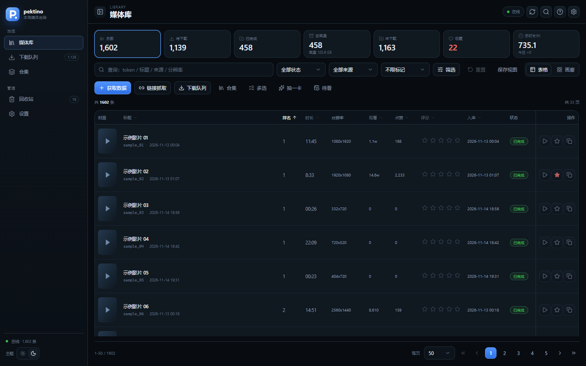
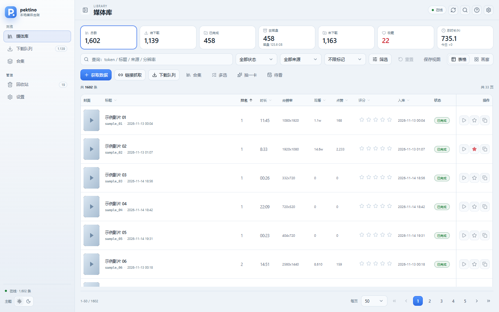
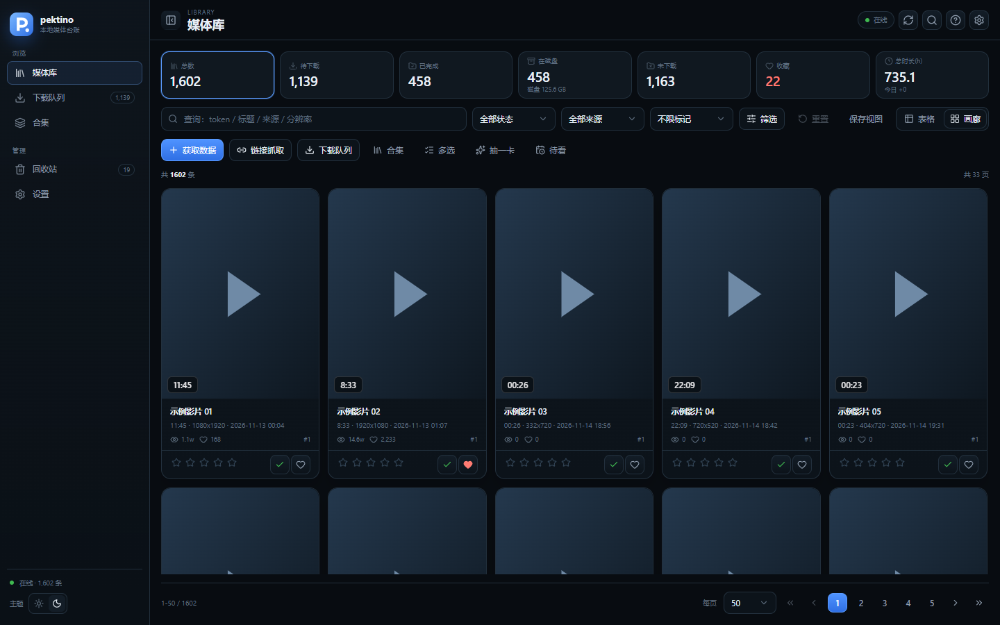
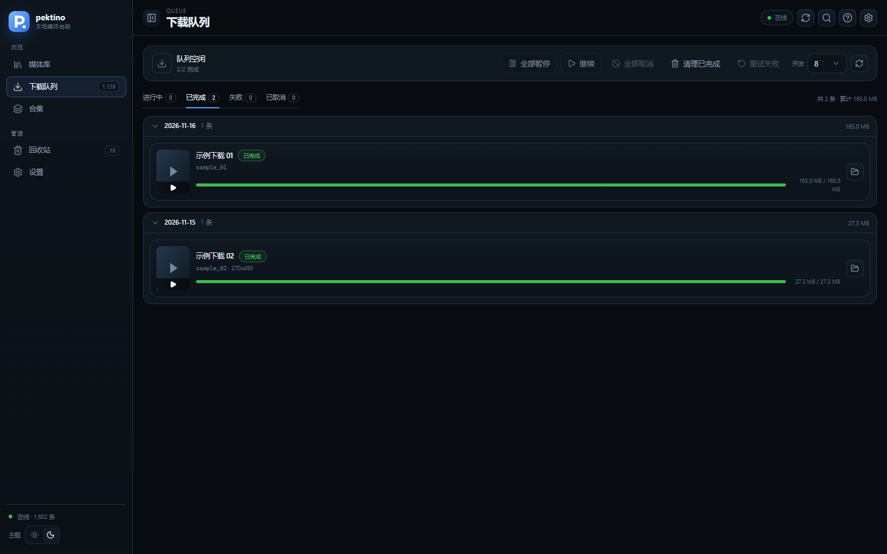
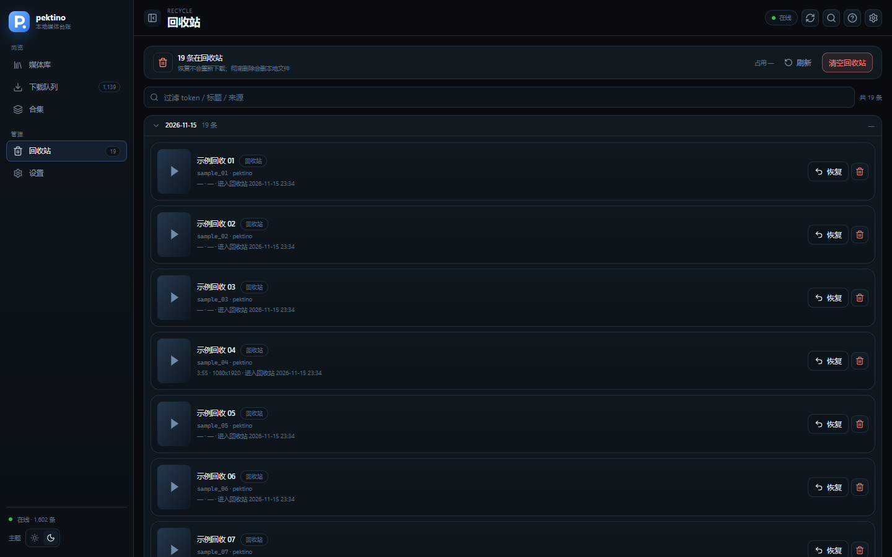
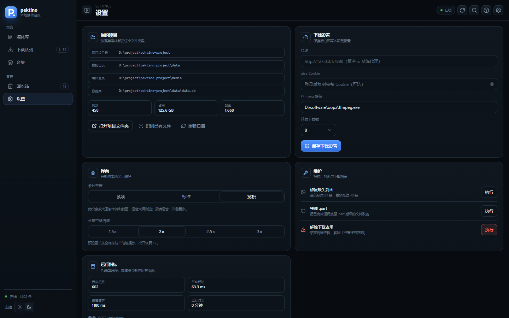

# pektino

本地的视频台账与下载管理工具：抓取榜单 → 生成直链 → 内置下载器 → 扫盘回填 → 表格 / 画廊浏览 → 打分 / 收藏 / 合集 / 抽卡。

全程在本机运行，服务只监听 `127.0.0.1`，不上传数据。

当前版本：**v3.0.0** · [更新日志](CHANGELOG.md) · [发版流程](docs/RELEASING.md) · [前端开发说明](web/README.md)

> v3.0.0 起，React 前端正式接管根路径 `http://127.0.0.1:8791/`。旧 `app/web` 仅保留作备份，不再作为入口。



> 截图为界面示意，封面与标题已替换为示例内容。
亮色主题：



## 截图

| 媒体库 · 画廊 | 下载队列 |
|---|---|
|  |  |

| 回收站 | 设置 |
|---|---|
|  |  |

## v3.0.0 亮点

### 新前端正式替代旧前端

- React 19 + Vite 8 + TypeScript + Tailwind 4
- 根路径直接服务新前端，`/new/` 自动重定向到 `/`
- 生产构建产物 `web/dist` 随仓库发布，不需要安装 Node.js
- 全新媒体库、画廊、预览播放器、下载队列、合集、回收站、设置页

### 媒体库

- 表格 / 画廊双视图，筛选、排序、分页
- 筛选条件同步到 URL，可保存为命名视图
- 表格操作列固定在右侧
- 批量选择、下载、合集、收藏、评分、移入回收站
- 收藏、评分、已看、待看、来源、状态、分辨率、时长筛选

### 预览播放器

- 浏览器内播放、上下条切换、全屏、画中画
- 空格播放/暂停，长按空格临时加速，时间右侧显示「正在加速播放」
- 倍速菜单、自动续播、记忆音量
- `←/→` 5 秒，`↑/↓` 音量，`F` 全屏，`M` 静音，`1–5` 评分
- 时间轴快照节点自动聚合，多个节点时点击打开时间轴
- 快照异步生成，不再阻塞播放窗口

### 下载队列

- 进行中 / 已完成 / 失败 / 已取消四个 tab
- 按放入队列时间倒序，日期分组
- 暂停 / 继续 / 取消 / 重试失败 / 清理完成
- 下载失败保留队列历史，不再清空整轮记录
- 代理初始化修复：qise 等需要代理的源可正常下载
- qise 签名 CDN 地址在下载前自动刷新，避免旧签名 410

### 数据安全

- 删除统一进入回收站，记录原状态和放入时间
- 恢复回到原状态，不再一律变成 `new`
- 彻底删除记录到 `deleted.json` 和 SQLite `deleted_tokens`
- 抓取跳过回收站与已彻底删除条目
- 无播放地址的异常抓取数据在入库前丢弃

### 抓取

- 源适配器：`pektino`、`qise`、`hsex`、`web`
- 在线榜单、链接抓取、本地视频文件夹导入
- 每轮抓取保存 `result.csv`、`meta.json`、`progress.json`、`scrape.log` 诊断文件
- 设置页日志可直接点击下载诊断文件
- 抓取失败会显示真实错误，不再静默完成 0 条

## 系统要求

| 项 | 要求 |
|---|---|
| 系统 | Windows 10 / 11（64 位） |
| PowerShell | **Windows PowerShell 5.1**（系统自带 `powershell.exe`） |
| 运行库 | 不需要 Node.js / Python / 数据库服务 |
| 浏览器 | Chrome / Edge 等现代浏览器 |
| 网络 | 能访问所启用的源；qise 默认跟随系统代理 |

> 不要用 PowerShell 7 / `pwsh` 启动：SQLite 组件是 .NET Framework 版本。

## 快速开始

1. 获取程序：
   ```powershell
   git clone https://github.com/OOPQ/pektino-console.git
   ```
   或下载 Release ZIP，解压到任意目录。
2. 双击 `start.cmd`。
3. 第一次启动选择项目文件夹，默认 `文档\pektino-project`。
4. 浏览器打开：
   ```text
   http://127.0.0.1:8791/
   ```

端口被占用时会自动向后寻找，实际地址以窗口打印为准。

命令行启动：

```powershell
.\start.cmd
.\start.cmd -Restart
powershell -ExecutionPolicy Bypass -File .\app\console.ps1 -Project D:\my-data
```

> 已经有实例在跑时，双击 `start.cmd` 只打开浏览器，不会重启。改了 `app\` 代码后用 `start.cmd -Restart`。

## 程序和数据分开

```text
<程序目录>
  start.cmd
  app\                  console.ps1 · server\ · lib\ · cli\ · sources\
  web\                  React 源码与构建配置
  web\dist\             已构建的前端（随发布包提供）

<项目文件夹>
  project.json
  data\                 data.db · config.json · ledger.csv · logs\ · diagnostics\
  media\                下载的视频
  cache\                封面和缩略图缓存，可删
```

升级程序不会动项目数据；换项目等于换一个数据目录。

- 路径可以含中文和空格
- 不要把项目放在 OneDrive / 坚果云 / 网络盘 / NAS 上，SQLite WAL 在同步盘上可能损坏
- 备份：整个项目文件夹；`data\` 必须备份，`media\` 建议备份，`cache\` 可删

## 网络与代理

抓取、封面、下载都要访问源站。设置 → 下载设置 → 代理：

- 留空：跟随系统代理
- 填写：例如 `http://127.0.0.1:7890`

配置保存在 `项目\data\config.json`。

## 抓取诊断

每轮抓取保存到：

```text
项目\data\diagnostics\scrape\<时间-来源-榜单>\
```

包含：

- `result.csv`：解析后的台账数据
- `meta.json`：来源、榜单、数量、错误、完成时间
- `progress.json`：任务进度
- `scrape.log`：抓取输出

设置页日志中会出现可点击的诊断文件链接，也可以直接访问：

```text
GET /api/diagnostics/scrape
GET /api/diagnostics/scrape/file?run=<run>&name=result.csv
```

## 测试

后端 25 项冒烟测试（独立临时项目，不碰真实数据）：

```powershell
powershell -NoProfile -ExecutionPolicy Bypass -File .\app\dev\test.ps1 -Start -Port 8899
```

前端单元测试：

```powershell
cd web
pnpm test
```

抓取冒烟测试（实际访问源站，默认每个榜单 10 条）：

```bat
app\tests\run-scrape-smoke.cmd
```

> 当前 Pektino 日榜页面没有视频数据，日榜会明确失败；这是源的现状，不会用其他榜单伪造日榜。

## 常见问题

| 现象 | 处理 |
|---|---|
| 双击窗口一闪而过 | 查看 `项目\data\logs\console.log` |
| 提示 PowerShell 版本不对 | 使用 `powershell.exe` 或 `start.cmd`，不要用 `pwsh` |
| 打开的是别的端口 | 8791 被占用，程序自动换端口，以窗口地址为准 |
| 下载失败 / 410 | 打开「下载队列 → 失败」查看错误；qise 会自动刷新签名地址 |
| 列表封面空白 | 设置 → 维护 → 修复缺失封面 |
| 点按钮 404 | 后台仍是旧进程，运行 `start.cmd -Restart` 后刷新 |
| 日榜抓取失败 | 源站日榜当前无数据，属于预期失败 |

## 数据与隐私

- 所有数据都在本机项目文件夹，程序不上传数据
- HTTP 服务只绑定回环地址，没有登录鉴权，不要改成对外监听
- 抓取和下载内容来自第三方站点，使用前请自行确认合规性

## 开发

前端源码在 [`web/`](web/README.md)：

```powershell
cd web
pnpm install
pnpm dev
```

开发地址 `http://127.0.0.1:5173/`，后端仍由 `app/console.ps1` 提供。

## 许可

[MIT](LICENSE)
